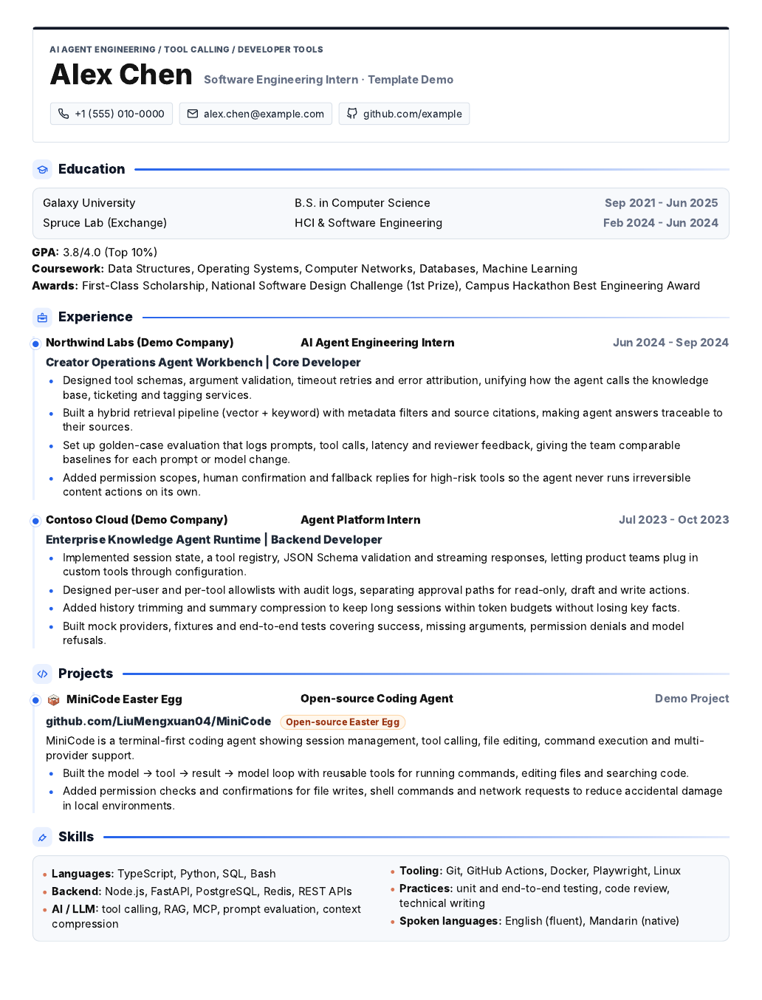

# English One-Page · 英文单页模板



适合外企、海外实习、留学申请等需要英文简历的投递。版式沿用[标准单页](../standard-one-page/README.md)，按英文简历的常见习惯做了调整：

- 不放证件照（欧美简历通常不放照片）；需要照片时可以从标准单页模板复制 `.photo-frame` 结构和样式。
- 西文字体优先（Inter / Helvetica Neue / Segoe UI / Arial），中文字体作为后备。
- 日期右对齐，正文左对齐，避免英文两端对齐时出现大空隙。
- 章节为 Education、Experience、Projects、Skills。

所有人名、学校、公司、项目、指标和联系方式均为 mock 演示内容，使用前必须替换为真实信息。

## 使用

在仓库根目录运行：

```bash
npm install
npm run preview -- templates/internship-employment/english-one-page/index.html
npm run export:pdf:english-one-page
```

输出文件：

```text
export/vibe-resume-english-one-page-demo.pdf
```
